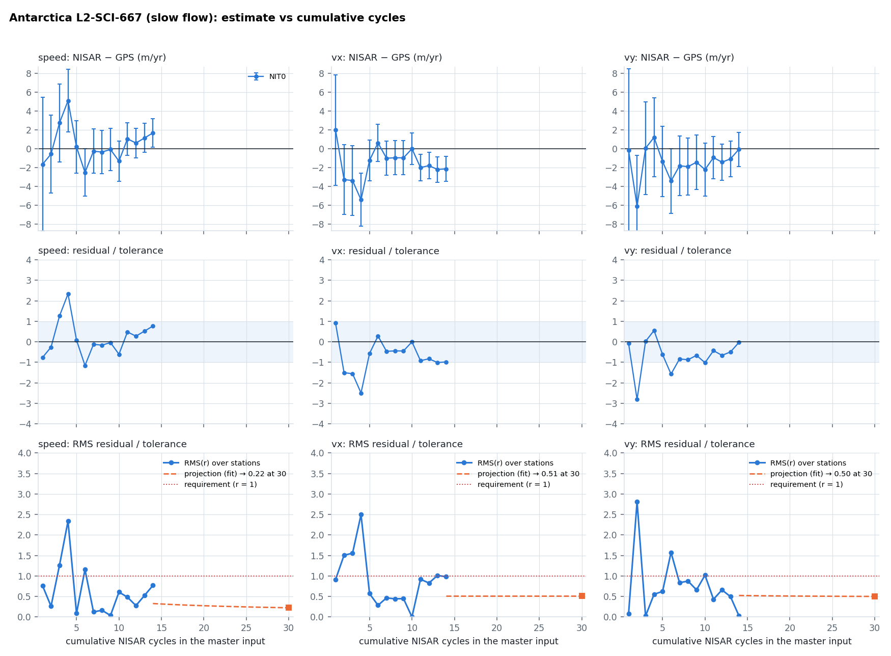
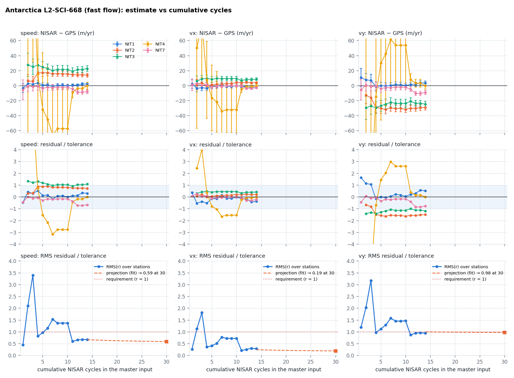
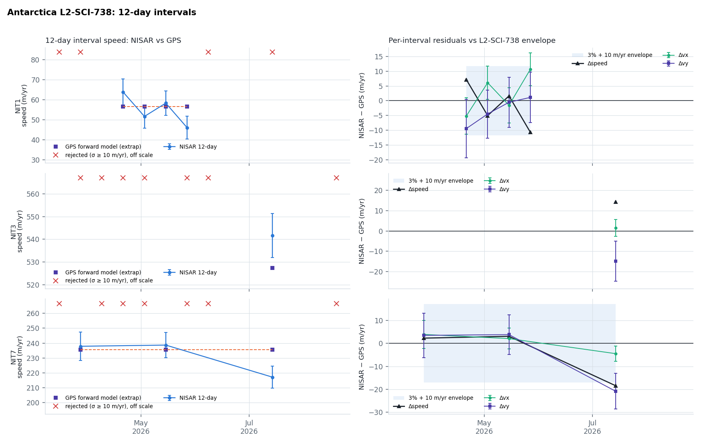
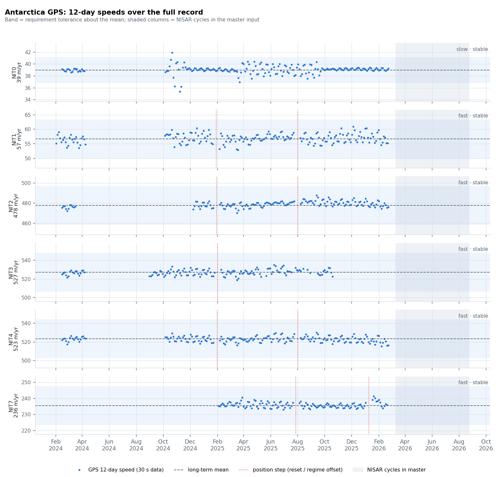
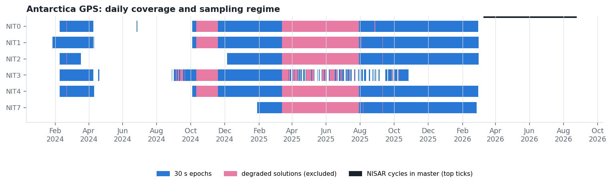

## Purpose

Automated validation of the NISAR ice-velocity requirements over Antarctica against the cal/val GPS network, rebuilt from the current master input and GPS parquet files. Observations come from `mosaic3d -obsDump` at the GPS pixels; the GPS is forward-modelled through the solver's own weights and windows so temporal sampling cancels exactly.

> **Status**
>
> - **L2-SCI-667** (slow): **insufficient data** — fewer than two usable stations
> - **L2-SCI-668** (fast): **met** — RMS residual/tolerance now: speed 0.67, vx 0.28, vy 0.94; projected at 30 cycles: speed 0.59, vx 0.19, vy 0.98; cycles needed: speed 4, vx 1, vy 15; 14 cycles, 5 stations, GPS extrapolated
> - **L2-SCI-738** (seasonal): **insufficient data** — no gated intervals with measured GPS

## Method

For each station the per-observation rows $(\mathbf a_i, d_i, \sigma_i, w_i)$ are solved as $\hat{\mathbf v} = (\sum_i w_i \mathbf a_i \mathbf a_i^{\mathsf T})^{-1} \sum_i w_i \mathbf a_i d_i$ with the surface-parallel projection, and the GPS is pushed through the same weights as $d_i^{\rm GPS} = \mathbf a_i \cdot \bar{\mathbf v}_{\rm GPS}(t_i, \Delta t_i)$. The residual $\Delta$ for speed, $v_x$ and $v_y$ is divided by the tolerance $T = 0.03\,|\mathbf v_{\rm GPS}| + c$ ($c$ = 1, 5, 10 m/yr). A requirement is met when the RMS of $\Delta/T$ over stations is $\le 1$; the projection fits $e^2(N) = a^2 + b^2/N$ to the cumulative-cycle series and evaluates it at N = 30 cycles.

GPS windows use every epoch inside the window (regression, not endpoint differencing); a window is `real` when it has data, `extrap` (long-term mean) at stations classed stable, `interp` between neighbouring windows otherwise, and rows without a reference are dropped from both solves.

## Results

**Figure 1.** Antarctica L2-SCI-667 (slow flow). NISAR − GPS per station with formal σ as cycles accumulate; residual over tolerance; RMS over stations with the projection to 30 cycles.

**Figure 2.** Antarctica L2-SCI-668 (fast flow). NISAR − GPS per station with formal σ as cycles accumulate; residual over tolerance; RMS over stations with the projection to 30 cycles.

**Figure 3.** Antarctica L2-SCI-738. Each 12-day cycle solved from its 12-day pairs against the GPS forward model over the same windows.

## GPS

**Figure 4.** Antarctica GPS 12-day speeds over the full record.

**Figure 5.** Antarctica GPS daily coverage and sampling regime.

### Stations

| station | class | stable | speed (m/yr) | record | steps | cycles | rows | real | interp | extrap | skip |
|---|---|---|---|---|---|---|---|---|---|---|---|
| NIT0 | slow | yes | 39.0 | 2024-02-09 → 2026-02-28 | 0 | 14 | 64 | 0 | 0 | 64 | 0 |
| NIT1 | fast | yes | 56.7 | 2024-01-27 → 2026-03-01 | 2 | 14 | 56 | 0 | 0 | 56 | 0 |
| NIT2 | fast | yes | 477.8 | 2024-02-09 → 2026-03-01 | 2 | 14 | 54 | 0 | 0 | 54 | 0 |
| NIT3 | fast | yes | 527.4 | 2024-02-09 → 2025-10-26 | 1 | 10 | 63 | 0 | 0 | 63 | 0 |
| NIT4 | fast | yes | 523.3 | 2024-02-09 → 2026-02-28 | 2 | 12 | 57 | 0 | 0 | 57 | 0 |
| NIT7 | fast | yes | 235.6 | 2025-01-28 → 2026-02-25 | 2 | 13 | 100 | 0 | 0 | 100 | 0 |

## Run information

- master input: `/Volumes/insar4/ian/Antarctica2026/Release/track-all/inputFile` (updated 2026-09-02 04:57)
- cycles: 15-28; observation rows: 394
- mosaic3d: `-SVConst -verticalCorrection /Volumes/insar10/ian/SMB/corrections/RacmoMARAvg-iceEquiv-1958-2021 -fl 1 -noVh -rOffsets -hopper3D -hopper3DMaxSigma -1 -timeThresh 37 -timePhaseThresh 10000 -timeOverlap`, squint off
- generated: 2026-09-02T15:08:23
