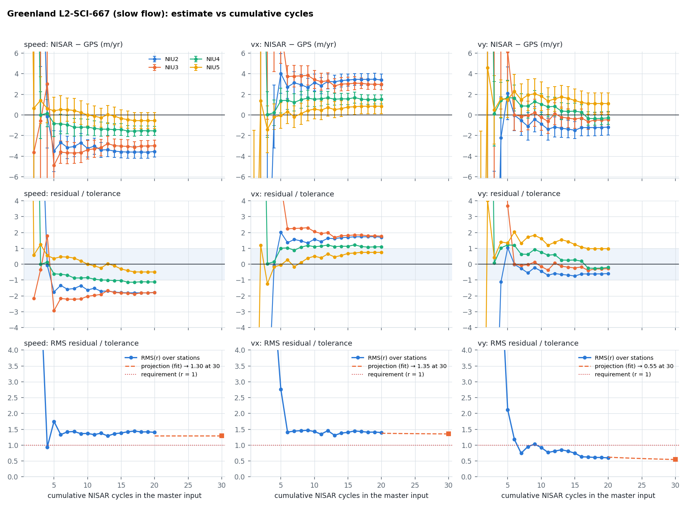
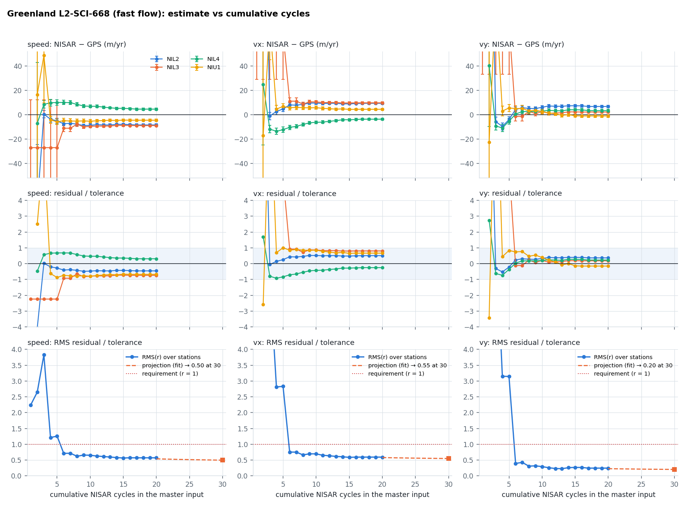
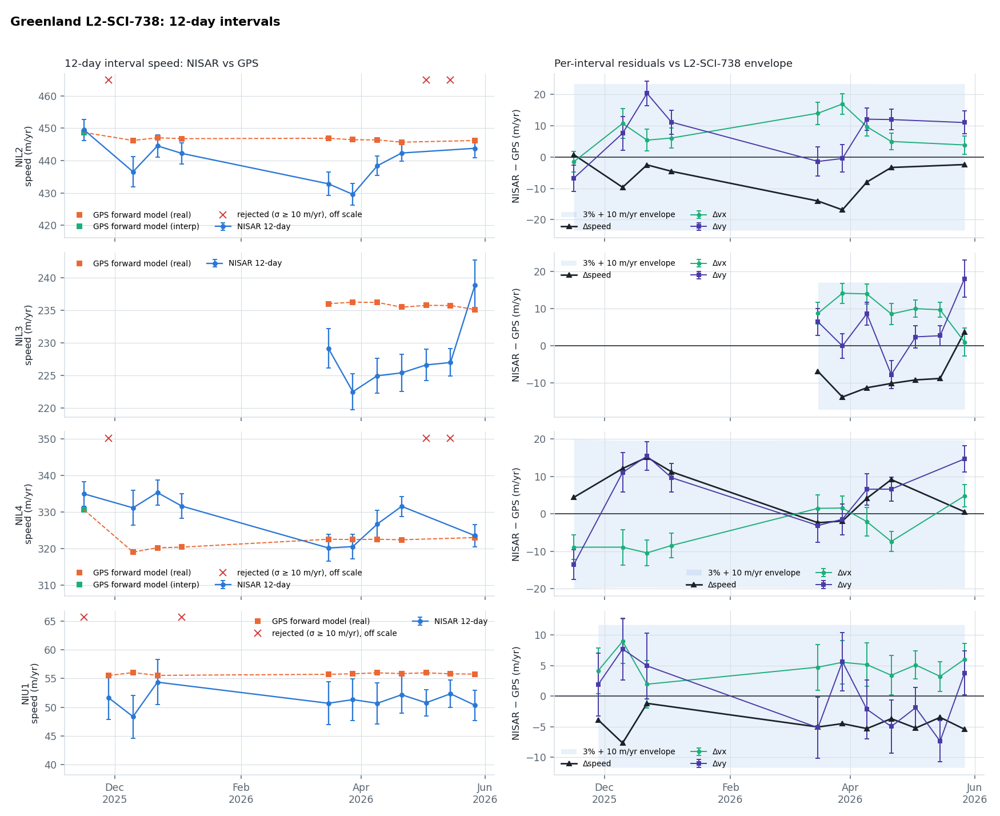
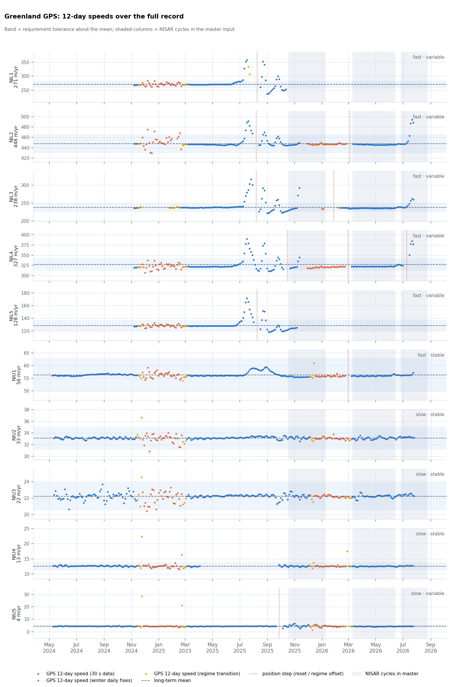
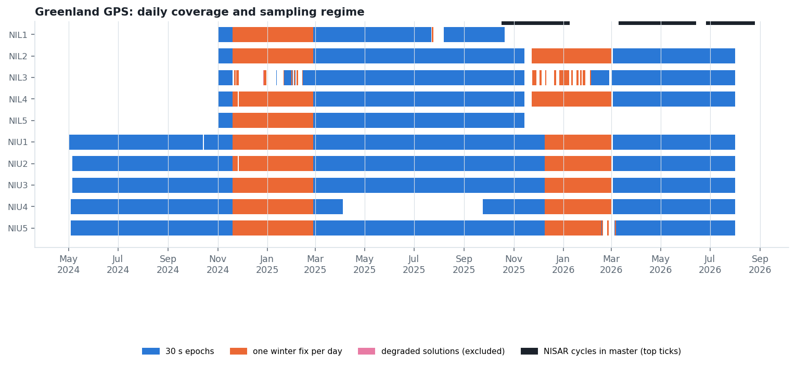

## Purpose

Automated validation of the NISAR ice-velocity requirements over Greenland against the cal/val GPS network, rebuilt from the current master input and GPS parquet files. Observations come from `mosaic3d -obsDump` at the GPS pixels; the GPS is forward-modelled through the solver's own weights and windows so temporal sampling cancels exactly.

> **Status**
>
> - **L2-SCI-667** (slow): **not met** — RMS residual/tolerance now: speed 1.40, vx 1.40, vy 0.60; projected at 30 cycles: speed 1.30, vx 1.35, vy 0.55; cycles needed: speed never at this bias, vx never at this bias, vy 6; 20 cycles, 4 stations, GPS measured
> - **L2-SCI-668** (fast): **met** — RMS residual/tolerance now: speed 0.57, vx 0.59, vy 0.25; projected at 30 cycles: speed 0.50, vx 0.55, vy 0.20; cycles needed: speed 4, vx 3, vy 1; 20 cycles, 4 stations, GPS measured
> - **L2-SCI-738** (seasonal): **met** — within envelope: speed 100%, vx 100%, vy 97%; 35/43 intervals gated (coverage 81%), 4 stations; RMS speed error 7.9 m/yr

## Method

For each station the per-observation rows $(\mathbf a_i, d_i, \sigma_i, w_i)$ are solved as $\hat{\mathbf v} = (\sum_i w_i \mathbf a_i \mathbf a_i^{\mathsf T})^{-1} \sum_i w_i \mathbf a_i d_i$ with the surface-parallel projection, and the GPS is pushed through the same weights as $d_i^{\rm GPS} = \mathbf a_i \cdot \bar{\mathbf v}_{\rm GPS}(t_i, \Delta t_i)$. The residual $\Delta$ for speed, $v_x$ and $v_y$ is divided by the tolerance $T = 0.03\,|\mathbf v_{\rm GPS}| + c$ ($c$ = 1, 5, 10 m/yr). A requirement is met when the RMS of $\Delta/T$ over stations is $\le 1$; the projection fits $e^2(N) = a^2 + b^2/N$ to the cumulative-cycle series and evaluates it at N = 30 cycles.

GPS windows use every epoch inside the window (regression, not endpoint differencing); a window is `real` when it has data, `extrap` (long-term mean) at stations classed stable, `interp` between neighbouring windows otherwise, and rows without a reference are dropped from both solves.

## Results

**Figure 1.** Greenland L2-SCI-667 (slow flow). NISAR − GPS per station with formal σ as cycles accumulate; residual over tolerance; RMS over stations with the projection to 30 cycles.

**Figure 2.** Greenland L2-SCI-668 (fast flow). NISAR − GPS per station with formal σ as cycles accumulate; residual over tolerance; RMS over stations with the projection to 30 cycles.

**Figure 3.** Greenland L2-SCI-738. Each 12-day cycle solved from its 12-day pairs against the GPS forward model over the same windows.

## GPS

**Figure 4.** Greenland GPS 12-day speeds over the full record.

**Figure 5.** Greenland GPS daily coverage and sampling regime.

### Stations

| station | class | stable | speed (m/yr) | record | steps | cycles | rows | real | interp | extrap | skip |
|---|---|---|---|---|---|---|---|---|---|---|---|
| NIL1 | fast | no | 270.5 | 2024-11-01 → 2025-10-20 | 1 | 16 | 108 | 0 | 0 | 0 | 108 |
| NIL2 | fast | no | 447.6 | 2024-11-01 → 2026-07-31 | 2 | 18 | 122 | 103 | 6 | 0 | 13 |
| NIL3 | fast | no | 237.6 | 2024-11-01 → 2026-07-31 | 2 | 17 | 124 | 80 | 0 | 0 | 44 |
| NIL4 | fast | no | 327.4 | 2024-11-01 → 2026-07-31 | 3 | 18 | 126 | 101 | 8 | 0 | 17 |
| NIL5 | fast | no | 128.4 | 2024-11-01 → 2025-11-13 | 1 | 16 | 101 | 2 | 0 | 0 | 99 |
| NIU1 | fast | yes | 56.3 | 2024-05-02 → 2026-07-31 | 1 | 16 | 95 | 95 | 0 | 0 | 0 |
| NIU2 | slow | yes | 33.1 | 2024-05-06 → 2026-07-31 | 0 | 18 | 133 | 125 | 0 | 8 | 0 |
| NIU3 | slow | yes | 22.2 | 2024-05-06 → 2026-07-31 | 0 | 20 | 107 | 97 | 0 | 10 | 0 |
| NIU4 | slow | yes | 12.5 | 2024-05-04 → 2026-07-31 | 0 | 20 | 144 | 127 | 0 | 17 | 0 |
| NIU5 | slow | no | 4.3 | 2024-05-04 → 2026-07-31 | 1 | 19 | 112 | 98 | 0 | 0 | 14 |

## Run information

- master input: `/Volumes/insar1/ian/NISAR/realNISAR/newGreenlandProject/Release/masterInput/inputFile` (updated 2026-09-02 08:46)
- cycles: 3-9, 15-22, 24-28; observation rows: 1172
- mosaic3d: `-SVConst -verticalCorrection /Volumes/insar10/ian/SMB/corrections/RacmoMARAvg-iceEquiv-1958-2021 -fl 1 -noVh -rOffsets -hopper3D -hopper3DMaxSigma -1 -timeThresh 37 -timePhaseThresh 10000 -timeOverlap`, squint off
- generated: 2026-09-02T15:08:08
